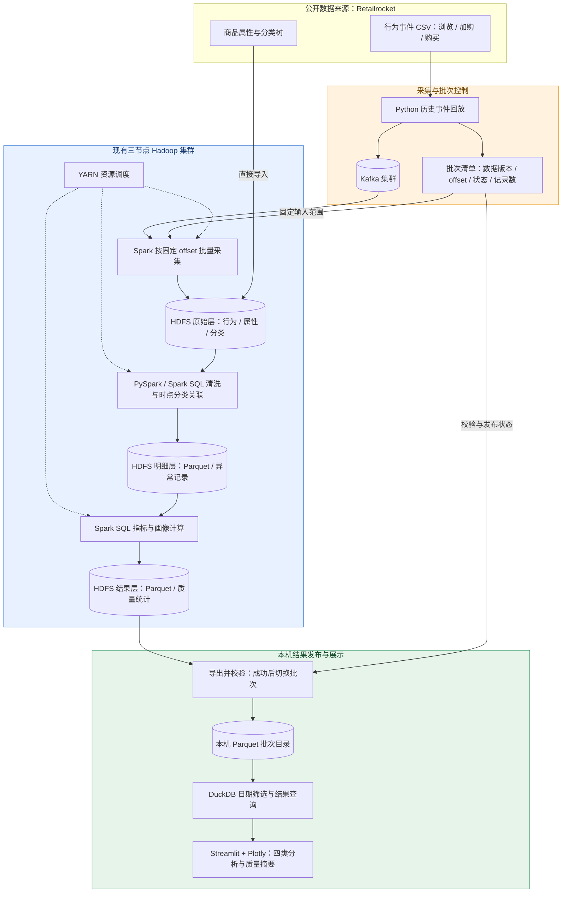

# 项目任务：基于 Kafka、Hadoop 与 Spark 的电商用户行为分析

## 1. 项目目标

在当前本地机器上，复用现有三节点 Hadoop / Kafka 集群，以 [Retailrocket 公开电商数据集](https://www.kaggle.com/datasets/retailrocket/ecommerce-dataset)为唯一数据源，实现历史行为回放采集、分布式存储、离线清洗分析和交互式可视化，构建可解释的用户行为画像。

项目必须实际使用 Kafka、HDFS 和 YARN 上的 Spark 分布式计算。首版以快速完成可运行系统为目标，手动触发批处理，不要求实时更新。

## 2. 数据采集与处理任务

1. 使用 Python 将浏览、加购、购买事件从原始 CSV 回放至 Kafka，保留原始事件时间，记录回放时间、数据版本、源文件和源行号。明确标注历史数据回放，不作为真实实时访问展示。
2. 回放前记录各分区起始 offset，确认发送完成后记录结束 offset；Spark 按确定范围批量采集至 HDFS 原始层。
3. 商品属性和分类树直接导入 HDFS，与行为数据绑定同一数据版本。
4. 使用 PySpark / Spark SQL 在 YARN 上执行清洗、去重、分类关联及分析，以 Parquet 保存明细和结果。
5. 将必要的访客粒度及聚合结果导出到本机，由 DuckDB 查询，Streamlit + Plotly 展示；看板不直接扫描 Kafka 或启动 Spark。
6. 开发使用固定小样本，最终验收处理完整行为数据。

## 3. 分析功能与指标口径

| 页面 | 必须实现的内容 |
| --- | --- |
| 行为概览 | 浏览、加购、购买事件数，独立访客数，按日趋势 |
| 转化分析 | 各行为独立访客数；浏览购买、加购购买的访客交集及占比 |
| 商品与分类 | 热门商品、热门分类、分类购买情况；匿名分类以原始编号展示 |
| 用户画像 | 活跃天数、事件次数、购买次数、最近活跃间隔、按浏览次数排序的分类偏好；购买行为单独展示 |
| 数据质量摘要 | 输入与有效记录数、异常记录数、疑似重复数量、分类关联覆盖率 |

- 所有分析以 UTC 原始事件时间为准，界面标明时区；日期筛选统一影响全部页面和画像。
- 转化指标为所选范围内的浏览购买交集除以浏览访客数、加购购买交集除以加购访客数。不要求行为顺序，不称为严格漏斗；分母为零显示无数据。
- 跨日独立访客和交集按访客去重，不能直接累加每日人数。
- 最近活跃间隔以筛选范围内最大事件时间为基准，无行为访客不进入当前画像列表；提供访客 ID 查询和分页。

## 4. 数据质量与批次可靠性

- 商品分类关联不晚于行为发生时间的最近分类记录；无匹配时保留为未知分类，不用未来记录补齐，并统计关联覆盖率。
- 时间无法解析、缺少访客或商品标识、行为类型不合法的记录隔离并统计，不进入正式指标；原始记录保留。浏览与加购缺少交易标识属于正常情况。
- 采集重试产生的同一源记录只计一次；源文件不同行中的相同内容保留，报告疑似重复数量。
- 每轮采集与分析建立独立批次，登记数据来源、Kafka offset 范围、记录数、处理状态和输出位置。同一批次重跑不重复累计。
- 每个发布批次为指定输入范围的完整快照；失败批次可重试，不覆盖此前成功结果。看板只读取最近成功发布的批次，显示批次及数据时间范围，缓存按批次和筛选条件区分。
- Kafka 用于采集传输，原始文件及 HDFS 原始层用于持久保存与重算，不依赖 Kafka 无限期保留消息。

## 5. 技术栈与复用范围

| 职责 | 技术选择 |
| --- | --- |
| 历史行为回放 | Python |
| 分布式采集 | Kafka，复用现有集群 |
| 分布式存储与资源调度 | HDFS HA、YARN，复用现有三节点集群 |
| 批量采集、清洗与分析 | PySpark / Spark SQL on YARN |
| 明细与结果格式 | Parquet |
| 看板查询与可视化 | DuckDB、Streamlit、Plotly |

现有集群位于 `/home/nanfl/Projects/hadoop-cluster`，HDFS 逻辑入口为 `hdfs://mycluster`。Java、Python、Spark 及 Kafka 连接器版本需验证兼容性后锁定；YARN 参数按实际资源配置。原始数据清洗、分类关联和指标计算在集群完成，本机仅查询导出结果并进行展示所需的范围聚合。

首版不依赖 `/home/nanfl/Projects/campus-market`，不新增商城、业务埋点、Hive、HBase、Superset、独立 API 或前端工程。ADB、MaxCompute、Quick BI 不是必选组件；年龄地域画像、销售额、推荐模型、流失预测及常驻流处理不纳入首版。

## 6. Mermaid 系统架构图

实线表示数据或控制信息流，虚线表示 YARN 对 Spark 作业的资源调度。

## 7. 交付物与验收标准

1. 提供数据准备、Kafka 回放、Spark 采集分析、结果导出及看板源码和可复现运行命令。
2. 完整行为数据经过 Kafka，核对发送数、消费数、唯一源记录数及异常数。
3. 提供 HDFS 文件及 YARN 作业证据，确认 Spark 实际跨节点执行，最终验收不使用 local 模式替代。
4. 完成四类分析页面及质量摘要，验证日期筛选、访客查询、分页和空数据展示。
5. 用已知小样本验证分类时点、采集去重、跨日访客去重、转化交集及日期边界。
6. 验证同批次重跑不使指标翻倍，失败批次不影响已发布看板。
7. 提供部署说明、锁定版本、数据来源及演示步骤。三个节点共用本机物理宿主，仅展示分布式执行，不宣称抵御宿主机故障。

需求细节见 [requirements.md](requirements.md)，模块边界见 [architecture.md](architecture.md)。
