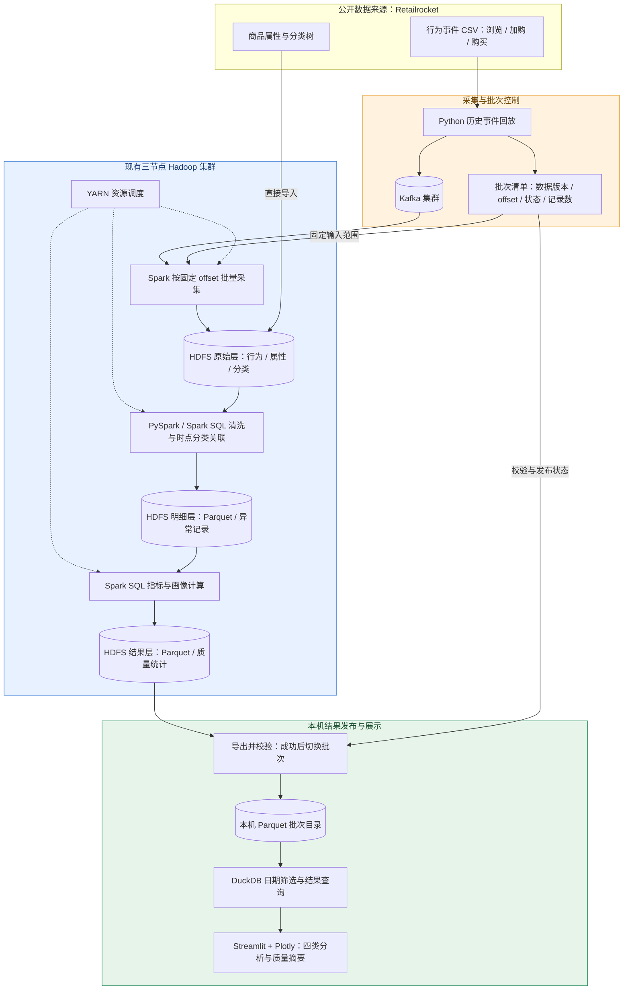

# 项目路线图：电商用户行为分析

| 版本 | 状态 | 主要交付 |
| --- | --- | --- |
| V1 | 已完成并验收 | 历史数据批处理分析、Streamlit 可视化、批次恢复与可靠发布 |
| V2 | 规划中，尚未实现 | 实时数据流监控与分析、React + TypeScript + Vite 页面交互与视觉升级 |

V1 / V2 表示项目里程碑，与 Retailrocket 数据集的 `version2`、`kaggle-retailrocket-v2` 以及已有批次 ID 中的 `v2` 无关。现有运行命令与验收记录对应 V1；既有 ADR 中的“首版”也对应 V1。

## V1：历史数据分析与批处理看板（已完成）

2026-10-19 已完成实现、合并至主分支并通过全量验收，关联规格及任务 #1–#8 已关闭。完整的 2,756,101 条行为经过 Kafka 和 HDFS，Spark 在 YARN 跨节点执行；28 项测试及定向回归、看板与发布恢复验证通过。详见 [全量验收证据](evidence/full/README.md)。以下为已交付的 V1 范围。

### 1. 项目目标

在当前本地机器上，复用现有三节点 Hadoop / Kafka 集群，以 [Retailrocket 公开电商数据集](https://www.kaggle.com/datasets/retailrocket/ecommerce-dataset)为唯一数据源，实现历史行为回放采集、分布式存储、离线清洗分析和交互式可视化，构建可解释的用户行为画像。

项目必须实际使用 Kafka、HDFS 和 YARN 上的 Spark 分布式计算。V1 以快速完成可运行系统为目标，手动触发批处理，不要求实时更新。

### 2. 数据采集与处理任务

1. 使用 Python 将浏览、加购、购买事件从原始 CSV 回放至 Kafka，保留原始事件时间，记录回放时间、数据版本、源文件和源行号。明确标注历史数据回放，不作为真实实时访问展示。
2. 回放前记录各分区起始 offset，确认发送完成后记录结束 offset；Spark 按确定范围批量采集至 HDFS 原始层。
3. 商品属性和分类树直接导入 HDFS，与行为数据绑定同一数据版本。
4. 使用 PySpark / Spark SQL 在 YARN 上执行清洗、去重、分类关联及分析，以 Parquet 保存明细和结果。
5. 将必要的访客粒度及聚合结果导出到本机，由 DuckDB 查询，Streamlit + Plotly 展示；看板不直接扫描 Kafka 或启动 Spark。
6. 开发使用固定小样本，最终验收处理完整行为数据。

### 3. 分析功能与指标口径

| 页面 | 必须实现的内容 |
| --- | --- |
| 行为概览 | 浏览、加购、购买事件数，独立访客数，按日趋势 |
| 转化分析 | 各行为独立访客数；浏览购买、加购购买的访客交集及占比 |
| 商品与分类 | 热门商品、热门分类、分类购买情况；匿名分类以原始编号展示 |
| 用户画像 | 活跃天数、事件次数、购买次数、最近活跃间隔、按浏览次数排序的分类偏好；购买行为单独展示 |
| 数据质量摘要 | 输入与有效记录数、异常记录数、疑似重复数量、分类关联覆盖率 |

- 所有分析以 UTC 原始事件时间为准，界面标明时区；日期筛选统一影响全部页面和画像。
- 转化指标为所选范围内的浏览购买交集除以浏览访客数、加购购买交集除以加购访客数。不要求行为顺序，不称为严格漏斗；分母为零显示无数据。
- 跨日独立访客和交集按访客去重，不能直接累加每日人数。
- 最近活跃间隔以筛选范围内最大事件时间为基准，无行为访客不进入当前画像列表；提供访客 ID 查询和分页。

### 4. 数据质量与批次可靠性

- 商品分类关联不晚于行为发生时间的最近分类记录；无匹配时保留为未知分类，不用未来记录补齐，并统计关联覆盖率。
- 时间无法解析、缺少访客或商品标识、行为类型不合法的记录隔离并统计，不进入正式指标；原始记录保留。浏览与加购缺少交易标识属于正常情况。
- 采集重试产生的同一源记录只计一次；源文件不同行中的相同内容保留，报告疑似重复数量。
- 每轮采集与分析建立独立批次，登记数据来源、Kafka offset 范围、记录数、处理状态和输出位置。同一批次重跑不重复累计。
- 每个发布批次为指定输入范围的完整快照；失败批次可重试，不覆盖此前成功结果。看板只读取最近成功发布的批次，显示批次及数据时间范围，缓存按批次和筛选条件区分。
- Kafka 用于采集传输，原始文件及 HDFS 原始层用于持久保存与重算，不依赖 Kafka 无限期保留消息。

### 5. 技术栈与复用范围

| 职责 | 技术选择 |
| --- | --- |
| 历史行为回放 | Python |
| 分布式采集 | Kafka，复用现有集群 |
| 分布式存储与资源调度 | HDFS HA、YARN，复用现有三节点集群 |
| 批量采集、清洗与分析 | PySpark / Spark SQL on YARN |
| 明细与结果格式 | Parquet |
| 看板查询与可视化 | DuckDB、Streamlit、Plotly |

现有集群位于 `/home/nanfl/Projects/hadoop-cluster`，HDFS 逻辑入口为 `hdfs://mycluster`。已验证并锁定既有 Java 8u212、Hadoop 3.1.3、Kafka 3.7.0，新增隔离的 CPython 3.11.16、Spark 3.5.6 / Scala 2.12 及匹配的 Kafka 连接器；YARN 资源参数与环境约束见[运行说明](operations/small-sample.md)。原始数据清洗、分类关联和指标计算在集群完成，本机仅查询导出结果并进行展示所需的范围聚合。

V1 不依赖 `/home/nanfl/Projects/campus-market`，不新增商城、业务埋点、Hive、HBase、Superset、独立 API 或前端工程。ADB、MaxCompute、Quick BI 不是必选组件；年龄地域画像、销售额、推荐模型、流失预测及常驻流处理不纳入 V1。

### 6. V1 Mermaid 系统架构图

实线表示数据或控制信息流，虚线表示 YARN 对 Spark 作业的资源调度。

### 7. 已完成的交付与验收

- [x] 提供数据准备、Kafka 回放、Spark 采集分析、结果导出及看板源码和可复现运行命令。
- [x] 完整行为数据经过 Kafka，核对发送数、消费数、唯一源记录数及异常数。
- [x] 提供 HDFS 文件及 YARN 作业证据，确认 Spark 实际跨节点执行，最终验收不使用 local 模式替代。
- [x] 完成四类分析页面及质量摘要，验证日期筛选、访客查询、分页和空数据展示。
- [x] 用已知小样本验证分类时点、采集去重、跨日访客去重、转化交集及日期边界。
- [x] 验证同批次重跑不使指标翻倍，失败批次不影响已发布看板。
- [x] 提供部署说明、锁定版本、数据来源及演示步骤。三个节点共用本机物理宿主，仅展示分布式执行，不宣称抵御宿主机故障。

V1 需求细节见 [requirements.md](requirements.md)，已实现的模块边界见 [architecture.md](architecture.md)，运行命令见根目录 [README](../README.md)。

## V2：实时数据流与 React 页面交互（规划中）

### 目标与范围

在 V1 已验证的数据口径和分布式链路上，增加可持续更新的数据流展示，并重建页面交互与视觉布局。数据源仍为 Retailrocket 历史行为回放，界面必须标明“历史数据回放”，不将它描述为真实用户正在访问商城。

| 展示位置 | 计划内容 | 指标用途 |
| --- | --- | --- |
| 清洗前：原始流监控 | 接收速率、累计消息量、分区 offset、处理进度与积压、最近消息样本 | 观察采集链路，不作为正式业务统计 |
| 清洗后：质量与业务分析 | 有效、异常、重试去重数量与原因，持续更新的行为趋势及访客指标 | 使用清洗后的结果，沿用 V1 业务口径 |
| 历史分析 | 保留 V1 已验收的概览、购买关联、商品分类、画像与质量查询能力 | 提供历史结果与实时结果的核对基准 |

接收时间用于观察回放与处理过程；原始事件时间继续按 UTC 用于历史业务分析。两种时间轴分别标注。实时结果展示处理进度、最近更新时间及结果是否完整，避免与 V1 已成功发布的完整批次混淆。

### 技术选择与待确认项

| 层次 | V2 计划 |
| --- | --- |
| 页面交互 | **React + TypeScript + Vite**，已选定的 V2 前端方向 |
| 视觉与组件 | 统一导航、指标卡片、筛选器、图表与表格布局；具体组件库和主题待确认 |
| 图表 | ECharts 为候选，尚未最终选型 |
| 查询与实时更新接口 | 复用 Python / DuckDB 查询能力；接口设计及轮询、SSE 或 WebSocket 方式待确认，FastAPI 为候选 |
| 流式清洗与聚合 | Spark Structured Streaming 微批处理为候选；状态、去重、检查点、恢复与输出方式需设计并验证 |
| 数据基础 | 复用既有 Kafka、HDFS、YARN 及持久化数据，不因页面升级重复建设采集链路 |

页面读取后台监控或分析服务提供的结果，不在浏览器中直接消费 Kafka，也不在页面刷新时启动 Spark。刷新周期、端到端延迟和资源预算以实测决定，尚未作秒级性能承诺。

### 计划实施顺序

- [ ] 使用 React + TypeScript + Vite 搭建统一页面，先接入 V1 结果，保持日期、访客查询与指标口径一致。
- [ ] 增加清洗前的 Kafka 原始流监控与回放进度展示。
- [ ] 增加清洗后的持续处理与质量、业务统计输出，并接入同一看板。
- [ ] 验证重复消息、异常、跨日访客、乱序数据、处理积压及中断恢复，核对实时与 V1 历史分析结果。
- [ ] 完成视觉、交互、端到端更新及真实跨节点运行验收，再将 V2 标记为完成。

### 与 V1 架构决策的关系

[ADR 0002](adr/0002-kafka-batch-ingestion.md) 记录的是 V1 的手动批处理决策，当前仍适用于已交付系统。V2 的持续流处理及独立前端 / 查询接口将扩展该边界；实施前应补充对应的架构决策和详细规格。V2 的规划不表示这些能力已经实现，也不改变 V1 的验收事实。
